# XUQIAN 加密站 · 分区操作手册（配图版）

本手册按**界面分区**逐步说明操作，每步都配有真实界面截图（截图由
`scripts/capture-guide.mjs` 驱动真实浏览器自动生成，不是手绘示意图）。

- 本地地址：**http://127.0.0.1:5188/**（或你部署的 HTTPS 地址）
- 文档索引（浏览器可直接打开）：**http://127.0.0.1:5188/docs/index.html**
- 首次使用建议先读 **§0 三个必须先知道的前提**
- 只想快速跑一遍：看 **§1 加密** 与 **§2 解密**

> 说明：本手册刻意**不使用页内锚点跳转**（中文标题生成的锚点在多数 Markdown
> 渲染器里会失效），请用编辑器的目录/大纲，或直接用下方表格定位。

> 版本提示：本轮新增的三项界面元素（**加密元数据**与**时间戳附加盐**两个勾选项、
> 「工具 → **密钥轮换**」面板、顶栏「**锁定**」按钮与设置里的**空闲自动锁定**）
> 在下方截图中尚未出现——截图由 `scripts/capture-guide.mjs` 重新生成后即会同步。
> 文字说明均已更新。

---

## 目录

| 分区 | 用途 | 所在小节 |
| --- | --- | --- |
| — | 三个必须先知道的前提 | §0 |
| 1 加密 | 文件加密，产出 `.XUQIAN` | §1（含 §1.1~§1.6） |
| 2 解密 | 用密钥还原文件 | §2（含 §2.1~§2.4） |
| 3 文本 | 直接加密/解密一段文本 | §3 |
| 4 工具 | 密码、哈希、文件头、分片、设置、日志 | §4（含 §4.1~§4.2） |
| — | 密钥弹窗（加密时必经） | §5 |
| — | 外观与语言 | §6 |
| — | 移动端 | §7 |
| — | 排错表 | §8 |

---

## 0 三个必须先知道的前提

1. **密钥只显示一次。** 每次加密生成一把 128 位主密钥，弹窗关掉就永久销毁，
   网站内没有任何入口能再次查看。丢了就真的没了。
2. **必须有办法拿到密钥。** 关弹窗前请至少完成其中一件：复制 Hex / 复制 Base64 /
   下载 `.XUQIANKEY` / 生成 Shamir 分片。
3. **批量加密只弹一次密钥弹窗**，所有文件共用同一把主密钥，因此一次备份即可解密全部文件。

---

## 1 加密分区

### 1.1 空态：认识界面

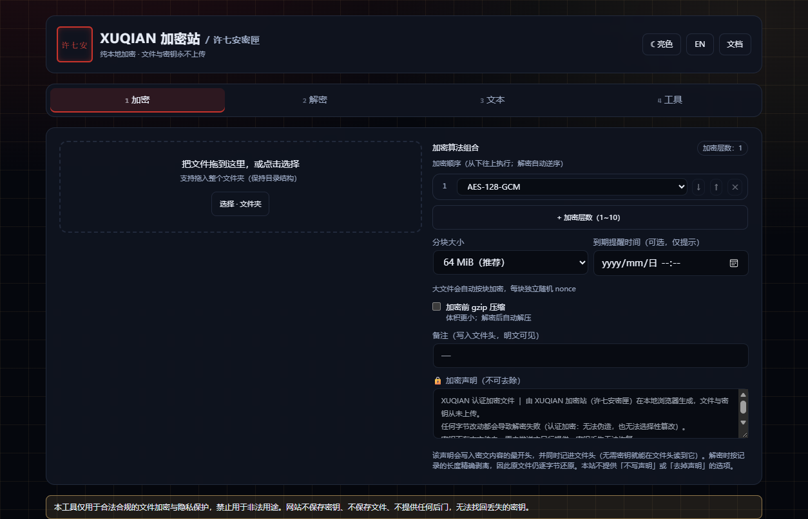

| 区域 | 说明 |
| --- | --- |
| 顶部品牌区 | 左：印章 + 站名；右：「亮色/暗色」与「EN/中文」 |
| 主标签栏 | `1加密 2解密 3文本 4工具`（键盘按 `1`~`4` 可直接切换） |
| 左侧拖拽区 | 拖文件或文件夹进来，也可以点它选择文件 |
| 右侧配置区 | 算法层栈、分块大小、到期提醒、gzip、备注、开始按钮 |

### 1.2 选择文件

**操作步骤**

1. 把文件**直接拖进**左侧虚线框（可多选）；
2. 或**点击虚线框**选择文件；
3. 或点「**选择 · 文件夹**」整目录导入（会保留相对目录结构）；
4. 队列里出现文件名与大小即表示已就绪，点条目右侧 `✕` 可移除，点「清空」清空全部。

> 支持拖入文件夹；`__MACOSX`、`.DS_Store`、`Thumbs.db` 会被自动忽略。

### 1.3 配置算法与选项

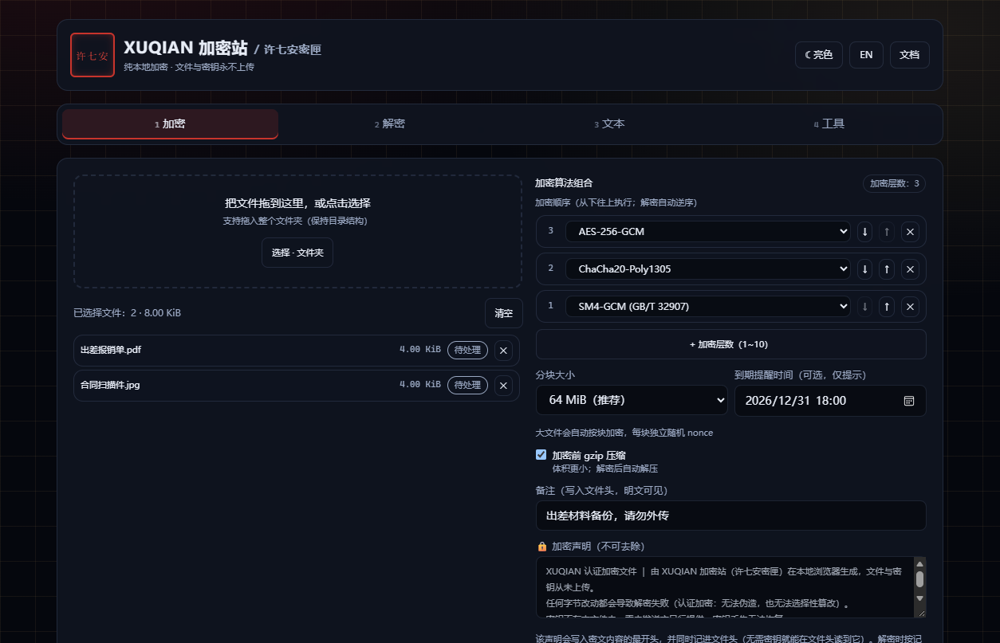

**算法层栈（核心）**

- 列表**自上而下显示、自下而上执行**。图中三层表示实际加密顺序为：
  `AES-256-GCM → ChaCha20-Poly1305 → SM4-GCM`，解密时自动逆序。
- 右上角 `加密层数：3` 显示当前层数，范围 1~10。
- 点「**+ 加密层数**」加一层，点每行右侧 `✕` 删一层。
- 用每行的 `↑` `↓` 调整顺序。**换顺序或换算法都会得到完全不同的密文**，
  所以解密必须用同一个 `.XUQIAN` 文件里记录的算法链（头部已记录，无需你记）。

支持的五种算法：

| 算法 | 说明 |
| --- | --- |
| AES-128-GCM | 走浏览器 WebCrypto，速度最快，推荐默认 |
| AES-256-GCM | 同样硬件加速，256 位密钥 |
| ChaCha20-Poly1305 | 软件实现，在无 AES 加速的设备上表现更好 |
| XChaCha20-Poly1305 | 24 字节 nonce，随机 nonce 更安全 |
| SM4-GCM | 国密 SM4（GB/T 32907）+ 标准 GCM |

**其他选项**

| 选项 | 建议 |
| --- | --- |
| 分块大小 | 默认 `64 MiB（推荐）`；超大文件可调 256 MiB |
| 到期提醒时间 | 可选。仅作为提示写入文件头，**纯前端无法强制自毁** |
| 加密前 gzip 压缩 | 文本/日志类文件能显著变小；已压缩过的图片视频收益很小 |
| **加密元数据** | **默认开启，建议保持**。把原文件名 / MIME / 备注一并加密——否则这些会**明文**写在文件头，任何人拿到密文都能看出"这是什么文件"。关闭后文件头更"透明"，便于人工排查 |
| **时间戳附加盐** | 默认关闭。仅做**域分离**（同一密钥在不同文件上派生出不同子密钥）。**它不提升安全性**：时间戳要明文存进文件头，公开的盐没有机密性 |
| 备注 | ⚠ 开启「加密元数据」时备注会一并加密；关闭时明文写入文件头，**不要写敏感内容** |
| 🔒 加密声明 | **不可去除**。留空则写入默认声明；声明同时写进密文内容最开头与文件头（**无需密钥即可读到**），解密时按记录长度精确剥离，因此原文件仍逐字节还原 |

> **关于加密声明**：它写在密文内容的最开头，并被认证加密覆盖——改动声明里的任何字节都会导致解密失败。
> 收件人用记事本打开 `.XUQIAN` 就能在文件头读到这段声明，因此很适合放"本件由谁加密、联系方式、使用须知"。
> 本站**不提供**"不写声明"或"去掉声明"的选项；把输入框清空也会回退到默认声明。
> 诚实的边界：持有密钥的人用**别的工具**重新加密，理论上仍能产出不带声明的文件；我们只保证本工具产出的文件一定带声明。

### 1.4 开始加密

点「**开始加密（N）**」按钮。加密过程中会显示进度：

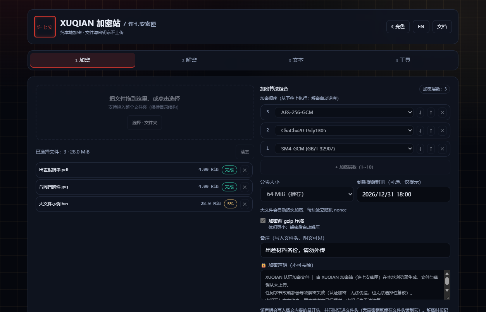

- 每个文件行右侧显示实时状态：`待处理` → `5%`/百分比 → `完成`；
- 底部出现「加密进度」进度条，按钮变为 `处理中…` 并禁用；
- 全部运算在本地 Worker 内完成，**此时不会产生任何网络请求**；
- 中途不要刷新或关闭页面（会丢失本次生成的主密钥）。

> 大文件会按「分块大小」自动切块加密，每块使用独立 nonce，因此内存占用不会随文件线性增长。

如果一次选了多个文件，队列会逐条处理：

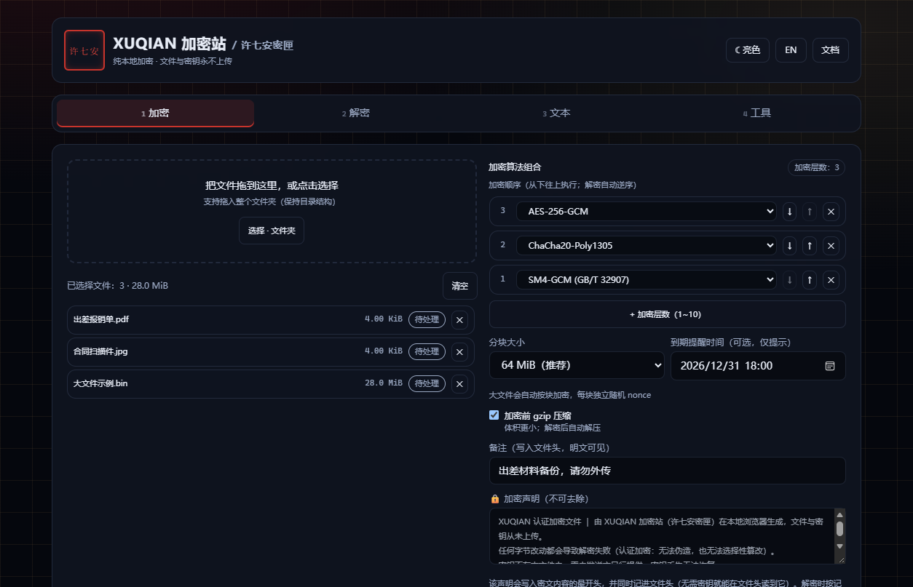

### 1.5 处理后事：密钥弹窗

加密完成后**必然**弹出密钥弹窗（见 **§5**）。
先备份密钥，再关闭弹窗。

### 1.6 下载密文

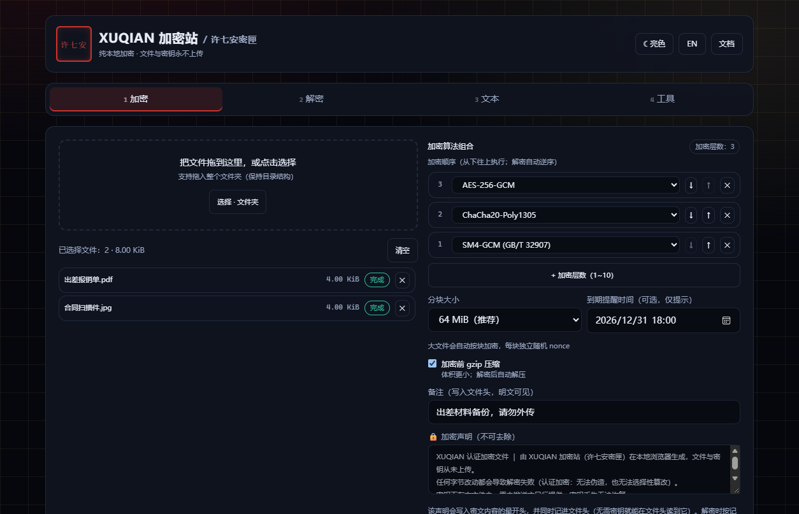

| 按钮 | 作用 |
| --- | --- |
| `下载 文件名.XUQIAN` | 逐个下载加密文件 |
| `下载 ZIP` | 多文件时打包为一个 ZIP，**保留原目录结构** |

> 输出命名规则：`原名.扩展名.XUQIAN`。例如 `出差报销单.pdf` → `出差报销单.pdf.XUQIAN`。
> 解密时会自动还原为原名。

---

## 2 解密分区

### 2.1 载入密文并输入密钥

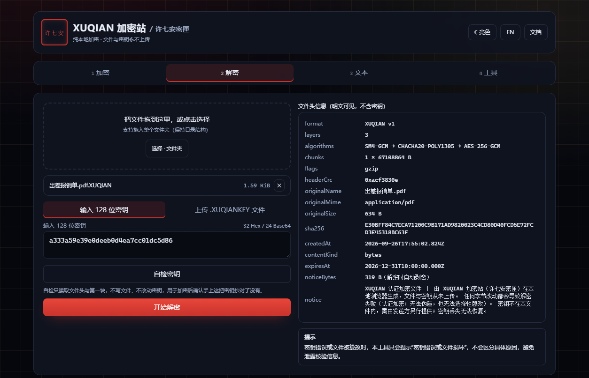

**操作步骤**

1. 拖入或选择 `.XUQIAN` 文件；
2. 右侧立刻显示**文件头信息**（明文可读，不含密钥）：算法链、层数、原文件名、
   原大小、SHA-256、创建时间、到期时间；
3. 在「输入 128 位密钥」框里粘贴密钥 —— 支持两种格式，自动识别：
   - **Hex**：32 个字符
   - **Base64**：24 个字符
4. 点「**开始解密**」。

> 粘贴时带空格、冒号、换行都没关系，会自动清理。

### 2.2 解密完成

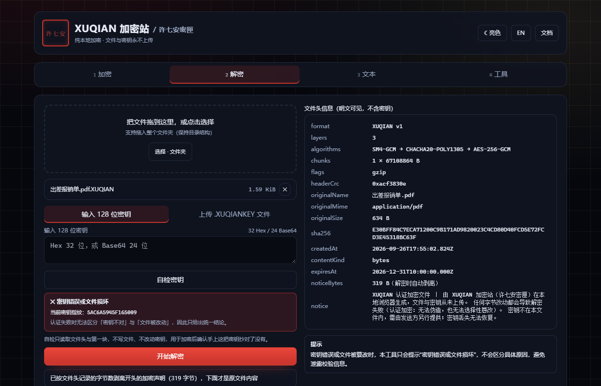

解密成功后：

- 显示 SHA-256 校验结果（与文件头记录的原文件哈希比对）：`一致 ✓` 表示文件完好；
- 点「**下载还原文件**」得到原始文件（文件名、内容都与加密前一致）；
- 网站**立即清除内存中的密钥与派生子密钥**，并清空输入框。

### 2.3 用 `.XUQIANKEY` 文件解密（推荐）

如果加密时下载了密钥文件，就不用手抄密钥：

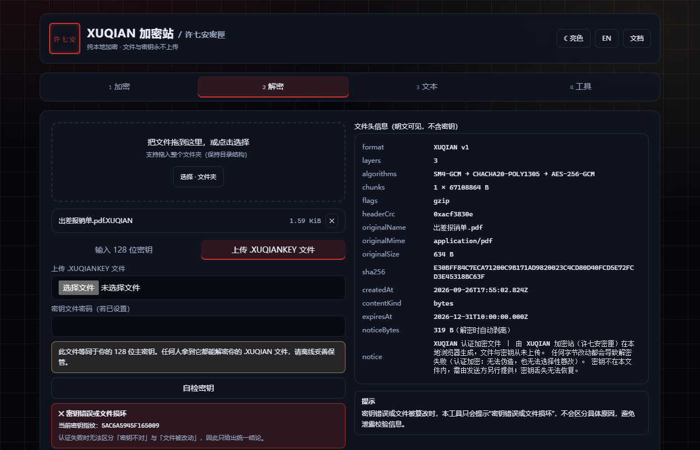

**操作步骤**

1. 点标签切换到「**上传 .XUQIANKEY 文件**」；
2. 选择你的 `.XUQIANKEY` 文件，出现「已载入：xxx.XUQIANKEY · 862 字节」；
3. 如果该密钥文件设置了密码，在「密钥文件密码」里输入；
4. 点「开始解密」。

> 载入中会显示「正在读取密钥文件…」并暂时禁用按钮，此时点击不会误报错误。

### 2.4 解密失败

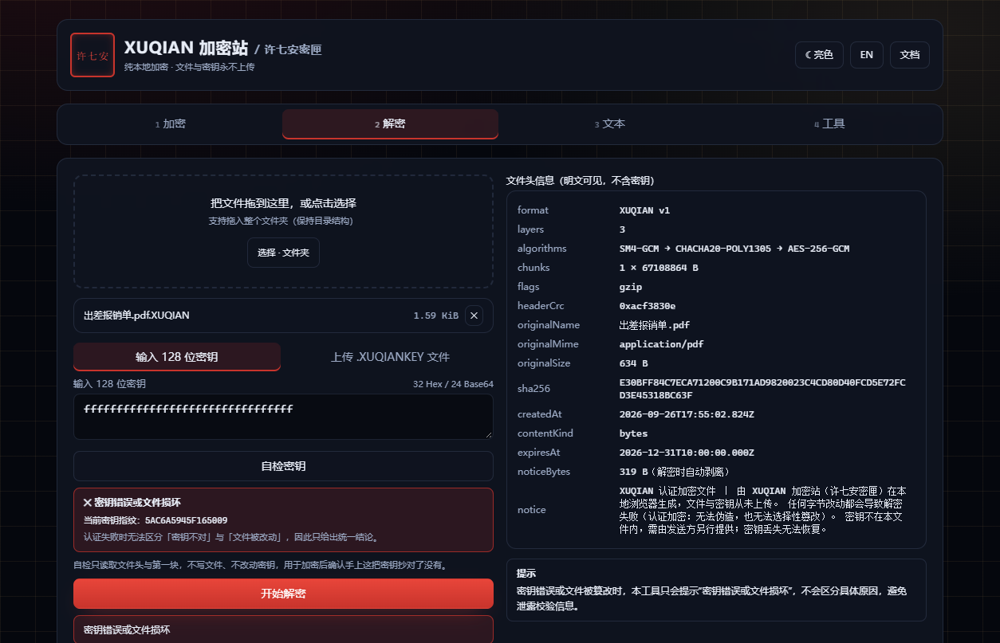

网站只会给出统一提示：**「密钥错误或文件损坏」**，不会告诉你具体是密钥错还是文件被改 ——
这是刻意设计，避免泄露可用于试探的信息。

遇到它请按顺序排查：

1. 密钥是否来自**这个文件**那次加密？（指纹比对：弹窗里的指纹 vs `.XUQIANKEY` 里的 `fingerprint`）
2. 密钥是否复制完整（32 位 Hex / 24 位 Base64，注意首尾字符）？
3. 文件是否被改动过（传输损坏、被编辑器保存过）？
4. 是否误传了别次的 `.XUQIAN` 文件？

---

## 3 文本分区

适合加密一小段文字（密码、口令、地址、私密备注），产出可直接粘贴分享的密文串。

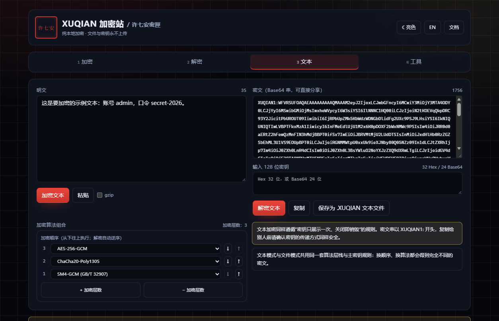

**加密步骤**

1. 左侧「明文」框输入内容（也可以点「粘贴」从剪贴板读入）；
2. 右下角算法层栈与加密分区共用，可改算法与顺序；
3. 点「**加密文本**」；
4. 弹窗备份密钥（**文本模式同样强制一次性展示**）：

   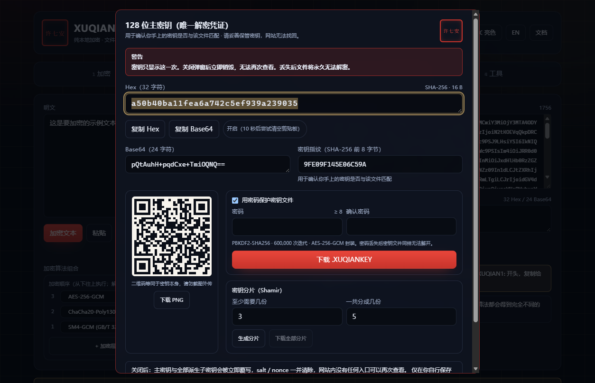

5. 关闭弹窗后，右侧「密文」框里就是结果 —— 以 `XUQIAN1:` 开头的 Base64 串。

**后续操作**

| 按钮 | 作用 |
| --- | --- |
| `复制` | 复制密文串，可直接发给别人（配合安全渠道传密钥） |
| `保存为 .XUQIAN 文本文件` | 存成文件，之后可在解密分区当普通 `.XUQIAN` 文件处理 |
| `解密文本` | 粘贴密文 + 密钥 → 还原明文（结果出现在左侧明文框） |

> 密文串与 `.XUQIAN` 文件是同一种容器，只是用 Base64 文本承载。
> 文本模式默认不会自动下载，所以密钥弹窗里请务必手动复制或下载。

---

## 4 工具分区

### 4.1 随机密码生成器 + 哈希校验

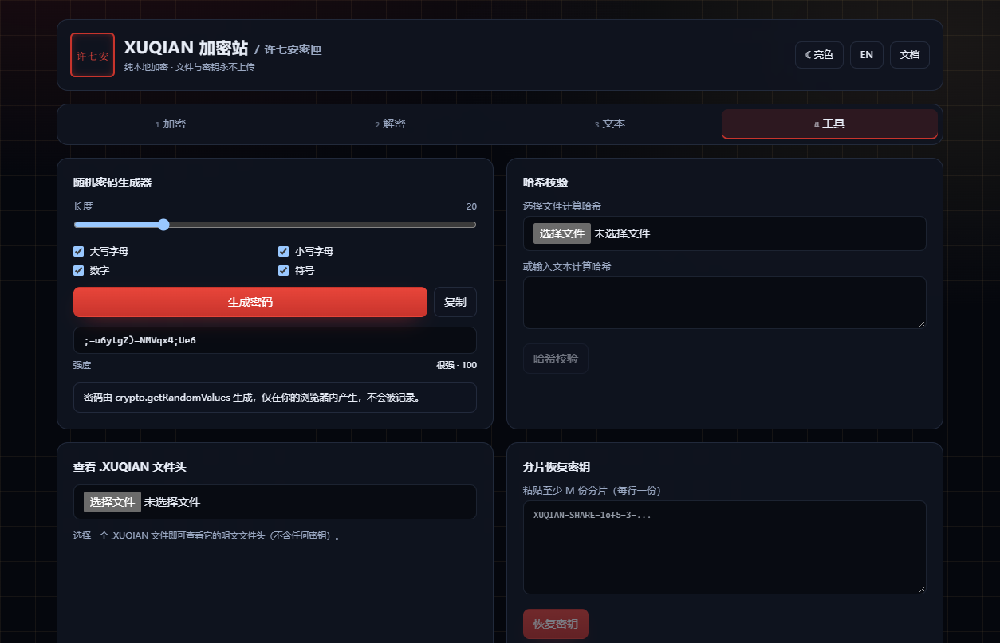

**随机密码生成器**

1. 拖动「长度」滑块（8~64）；
2. 勾选需要的字符类型（大写 / 小写 / 数字 / 符号），至少选一种；
3. 点「**生成密码**」；结果下方给出强度评估；
4. 点「复制」取用。

> 随机源是 `crypto.getRandomValues`，每个选中类别至少出现一次，之后整体洗牌。

**哈希校验**

1. 点「选择文件」计算某个文件的 SHA-256 与 SHA-512；**或**在下方文本框输入内容；
2. 点「哈希校验」；
3. 结果按算法分行展示，可复制比对。

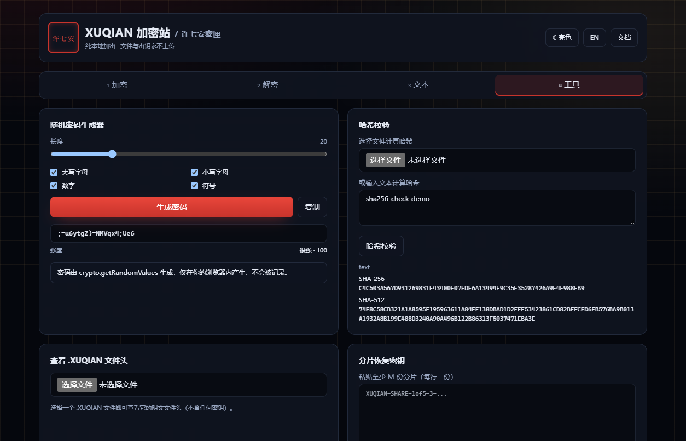

### 4.2 查看文件头 · 分片恢复 · 设置 · 日志

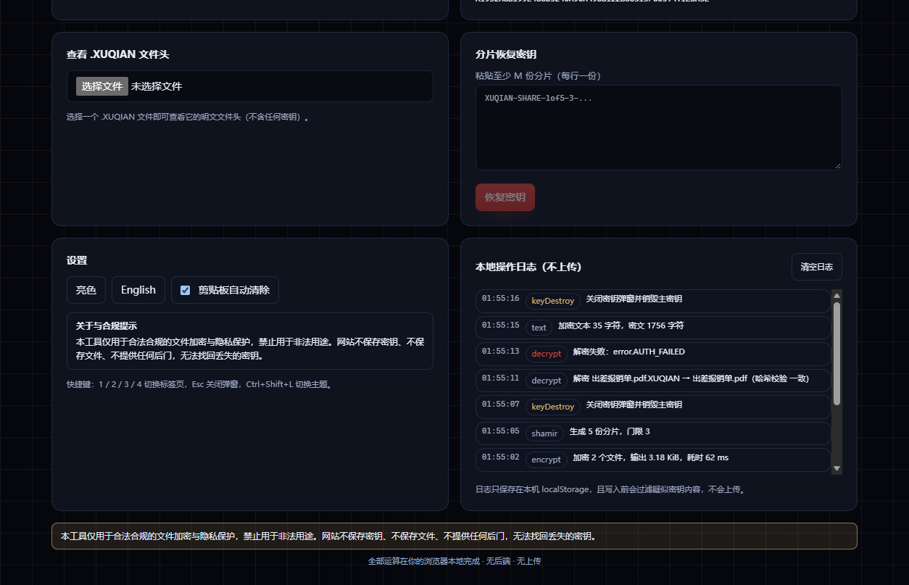

**查看 `.XUQIAN` 文件头**：选一个 `.XUQIAN` 文件，即可看到它的明文头部
（算法、层数、原文件名、哈希等）。**用来确认"这个文件是什么、需要几层什么算法"，不涉及密钥。**
若加密时开启了「加密元数据」，这里会显示"元数据已加密"，且**读不到**原文件名。

**分片恢复密钥**：把你的 Shamir 分片**每行一份**粘贴进来（至少 M 份），
点「恢复密钥」。成功后页面显示 Hex / Base64 / 指纹，并**自动下载**对应的 `.XUQIANKEY`。

**密钥轮换（更换口令）**：选择 `.XUQIANKEY` → 填当前口令 → 填新口令（会实时显示强度条）
→ 点「生成新密钥文件」。**只重封装密钥文件、不重加密数据**：主密钥与指纹都不变，已有密文继续可用。
若泄露的是主密钥本身，请改用新主密钥重新加密文件。

**设置**

| 项 | 说明 |
| --- | --- |
| 亮色/暗色 | 同顶部按钮 |
| 语言 | 中/英切换 |
| 剪贴板自动清除 | 复制密钥后 10 秒尝试清空剪贴板（浏览器需页面保持聚焦） |
| 空闲自动锁定 | 无操作达设定时长（1/5/15/30/60 分钟）即销毁主密钥、清空明文；可选关闭 |

**本地操作日志**：记录加解密、哈希、密钥生成/销毁等动作，
只存在本机 `localStorage`，写入前会用正则过滤疑似密钥的长串，**不会上传**，可随时清空。

---

## 5 密钥一次性展示弹窗（最高优先级）

只要发生加密（文件或文本），这个弹窗一定会出现，且**不可跳过**。

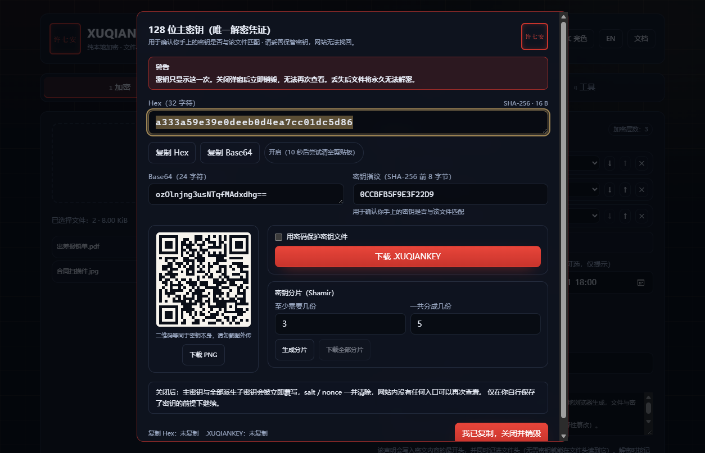

### 5.1 弹窗内容

| 元素 | 说明 |
| --- | --- |
| 红色警告 | 「密钥只显示这一次。关闭弹窗后立即销毁，无法再次查看。丢失后文件将永久无法解密。」 |
| Hex | 32 个字符，**打开时已自动全选**，可直接 `Ctrl+C` |
| Base64 | 24 个字符，另一个可复制格式 |
| 密钥指纹 | SHA-256 前 8 字节，用于确认"手上的密钥是不是这把" |
| 二维码 | 扫一下即可保存密钥。**二维码等同于密钥**，别截图外传 |
| 复制 Hex / 复制 Base64 | 点击后按钮变为 `✓ 已复制`，页脚状态同步更新 |
| 下载 `.XUQIANKEY` | 勾选「用密码保护密钥文件」可加密码（PBKDF2 60 万次 + AES-256-GCM） |
| 密钥分片（Shamir） | 设置 M/N 后「生成分片」，再「下载全部分片」 |
| 底部按钮 | `我已复制，关闭并销毁` |


### 5.2 关闭与二次确认

点「我已复制，关闭并销毁」：

- 若**已经**复制或下载过 → 直接关闭；
- 若**尚未**复制也未下载 → 先弹二次确认：

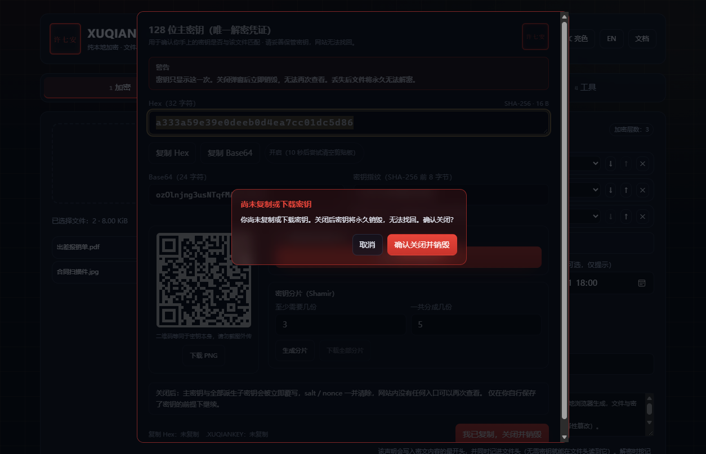

确认后立即执行销毁：命令 Worker 覆写主密钥 → 清空 salt / nonce / 派生子密钥 →
清空弹窗状态 → 卸载弹窗 DOM。**此后网站内没有任何入口能再次看到这把密钥。**

### 5.3 密码保护 + 分片

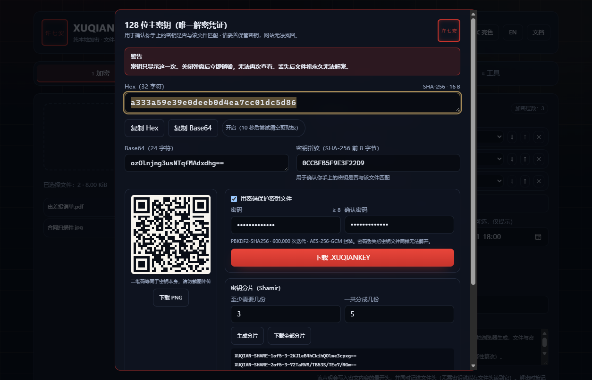

1. 勾选「用密码保护密钥文件」，输入两次密码（≥8 位）；
2. 点「下载 .XUQIANKEY」→ 得到一个**加密过的**密钥文件（`protected: true`）；
3. 分片区设置「至少需要几份 / 一共分成几份」（如 3/5），点「生成分片」；
4. 点「下载全部分片」得到一个文本文件，内含 N 行分片；
5. 把分片分发给不同保管人 —— 任意 M 份可恢复，少于 M 份得不到任何信息。

---

## 6 外观与语言

右上角两个按钮随时可用：`☾ 亮色 / ☀ 暗色` 切换主题，`EN / 中文` 切换语言。

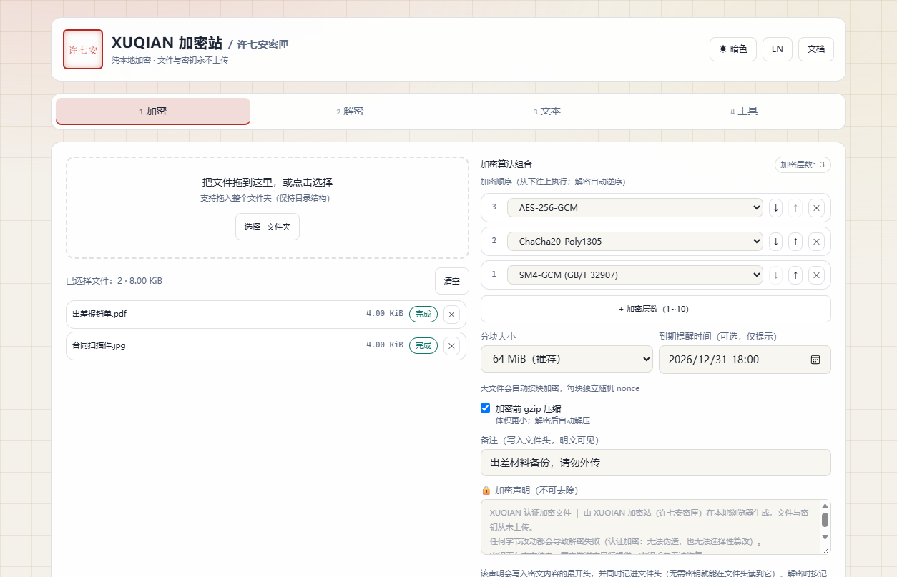

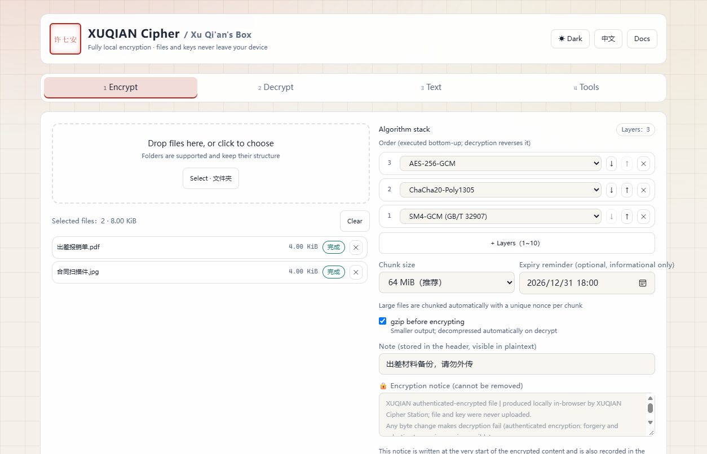

快捷键：

| 按键 | 作用 |
| --- | --- |
| `1` `2` `3` `4` | 切换 加密 / 解密 / 文本 / 工具 |
| `Esc` | 关闭弹窗 |
| `Ctrl+Shift+L` | 切换亮色/暗色 |

---

## 7 移动端

手机浏览器直接打开同一地址即可，布局自动变单列。

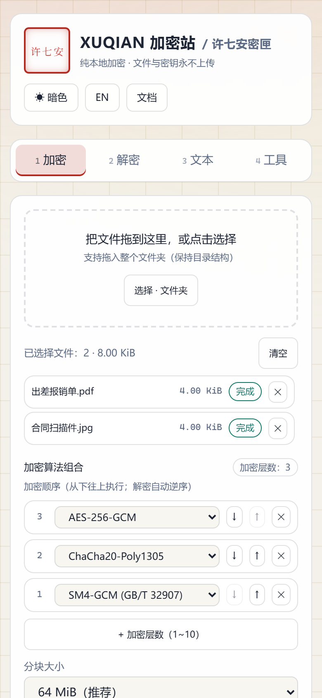

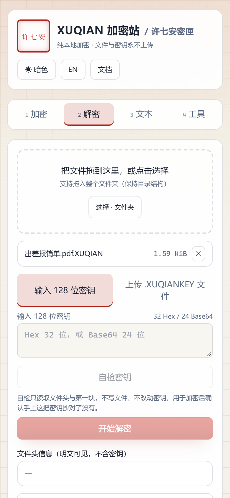

移动端注意事项：

- 拖拽在手机上不方便，请用「点击选择」或系统文件选择器；
- 密钥弹窗在小屏上可滚动，**务必要滑到底部点关闭按钮**；
- 建议手机与电脑分工：电脑加密、手机只做解密查看。

---

## 8 排错对照表

| 现象 | 原因 | 处理 |
| --- | --- | --- |
| 「密钥错误或文件损坏」 | 密钥不对，或文件被改动 | 用指纹核对密钥；确认文件未被编辑/损坏 |
| 「当前没有可用密钥」 | 没输入密钥，或密钥文件还没读完 | 填入密钥或重新选 `.XUQIANKEY`；等待「正在读取密钥文件…」消失 |
| 「密码错误或密钥文件损坏」 | `.XUQIANKEY` 的密码不对 | 换正确密码；密码丢失则该密钥文件无法解开，只能用另一份备份 |
| 「不是有效的 .XUQIAN 文件」 | 文件被截断，或根本不是 `.XUQIAN` | 检查传输完整性；用「查看 .XUQIAN 文件头」确认 |
| 「不是有效的 .XUQIANKEY 密钥文件」 | 选错了文件 | 确认选的是 `xxx.XUQIANKEY` |
| 加密按钮变灰 | 队列为空，或正在加密/读取中 | 先添加文件 |
| 关闭弹窗后找不到密钥 | **设计如此** | 只能用原文件重新加密生成新密钥 |
| 分片恢复失败 | 分片数量不足，或混入了不同批次分片 | 确认是同一批、且至少 M 份、每行一份 |
| 大文件很慢 | 分块 + 多层加密的固有成本 | 降低层数，或把分块调大 |

---

## 附：截图如何重新生成

界面改动后可一键重新生成全部配图（需先启动 `pnpm dev`）：

```bash
node scripts/capture-guide.mjs
```

脚本会启动真实浏览器、走一遍加密/解密/文本/工具全流程，把 24 张截图输出到
`docs/images/`，并写入 `docs/images/shots.json` 记录每张图的含义。

> `docs/images/` 目录里共有 **31 张** PNG：脚本产出的 24 张（下表）+ 7 张 `now-*` 现状图（见文末「现状图」小节）。

截图清单：

| 文件 | 内容 |
| --- | --- |
| `01-home-encrypt-empty.png` | 首页 / 加密分区空态 |
| `02-encrypt-configured.png` | 加密分区：三层算法 + gzip + 备注 + 到期提醒 |
| `03a-encrypt-queued-bigfile.png` | 加密分区：多文件队列 |
| `03-encrypt-progress.png` | 加密进行中：进度条 67% + 逐文件状态 |
| `04-key-modal.png` | 密钥一次性展示弹窗 |
| `05-key-confirm.png` | 未备份就关闭的二次确认 |
| `06-key-password-shamir.png` | 密码保护密钥文件 + Shamir 分片 |
| `07-encrypt-results.png` | 加密完成：下载按钮与 ZIP |
| `08-decrypt-loaded.png` | 解密分区：密文 + 明文文件头 + 密钥输入 |
| `08a-selfcheck-match.png` | 密钥自检：只读文件头与首块即可判定密钥是否匹配 |
| `08b-selfcheck-mismatch.png` | 密钥自检：错误密钥给出统一结论并显示当前密钥指纹 |
| `09-decrypt-done.png` | 解密完成 + SHA-256 校验一致 |
| `10-decrypt-failed.png` | 错误密钥的统一提示 |
| `11-decrypt-keyfile-mode.png` | 切换到 `.XUQIANKEY` 解密模式 |
| `12-text-key-modal.png` | 文本加密的密钥弹窗 |
| `13-text-panel.png` | 文本分区：明文 → 密文串 |
| `14-tools-password.png` | 随机密码生成器 |
| `15-tools-hash.png` | SHA-256 / SHA-512 校验结果 |
| `16-tools-inspect-shamir.png` | 文件头查看 / 分片恢复 / 设置 / 日志 |
| `17-light-theme.png` | 亮色主题 |
| `18-english.png` | 英文界面 |
| `19-mobile-encrypt.png` | 移动端加密分区 |
| `20-mobile-decrypt.png` | 移动端解密分区 |
| `21-key-qr.png` | 密钥二维码特写 |

### 现状图（`now-*`，7 张）

这一组不在上面的脚本产出里，是后来为「两条加密路线并存」改造补拍的**当时界面现状**，
用来对照改造前后的差异（例如开始页新增了路线选择、自研路线从占位页变成五入口工作台）。

| 文件 | 内容 |
| --- | --- |
| `now-01-encrypt.png` | 现状：简单加密 · 加密分区 |
| `now-02-decrypt.png` | 现状：简单加密 · 解密分区 |
| `now-03-text.png` | 现状：简单加密 · 文本分区 |
| `now-04-tools.png` | 现状：简单加密 · 工具分区 |
| `now-05-keymodal.png` | 现状：密钥一次性展示弹窗 |
| `now-06-start.png` | 现状：**开始页（两条路线二选一）** |
| `now-07-self.png` | 现状：**自研路线工作台五个入口** |

> 说明：这 7 张目前**没有被其它文档引用**（属于历史留档）。若不再需要对照，可以直接删除；
> 要长期保留的话，建议在 `PROJECT-REPORT.md` 的「网页内容框架」一节里引用 `now-06` / `now-07`。
