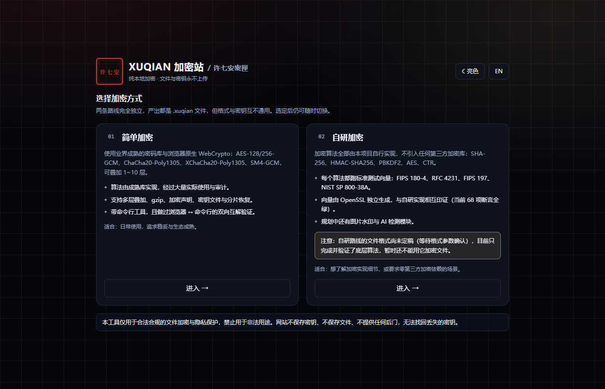
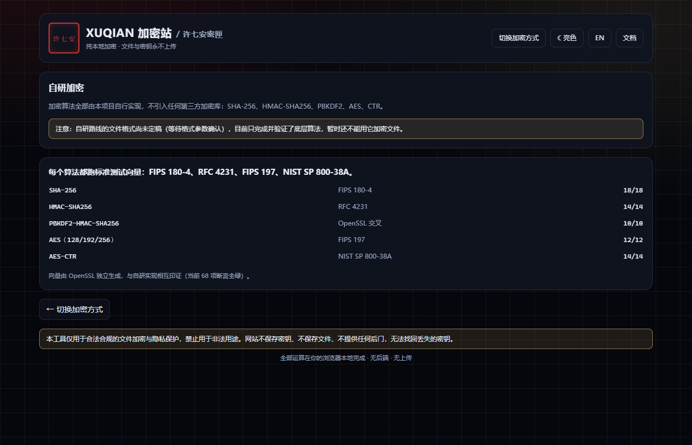

# XUQIAN 加密站 · 综合报告

> 生成时间：2026-10-04 ｜ **最后更新：2026-10-04（自研路线阶段零～七全部落地后重写）** ｜ 对应代码：工作区 `C:\Users\xuqian\Desktop\dsh 加密网站`
> 本报告面向"接手这个项目的人 / 下一个会话的 AI"：看完应当能明白**它是什么、网页长什么样、两条加密路线怎么分工、格式怎么定的、测到什么程度、还差什么**。
>
> ⚠ **本版修订说明**：上一版写于自研路线**开工之前**，其中"自研格式未定稿、暂不可用""阶段二阻塞"等表述**已经作废**。
> 自研路线现已全部落地（格式、加密解密、水印、AI 检测、界面、存储、测试），本版按实际情况重写了第 1.5、2、3.3、4.1、6、8、9、10 节。
> 逐项决策记录见 [`src/selfcrypto/README.md`](../src/selfcrypto/README.md)（D1–D34）。
>
> **最近一轮（2026-10-06）围绕"数据保护"定位补强了 5 项能力**：① 简单路线**元数据加密**（原文件名等默认加密）；
> ② **空闲自动锁定** + 手动锁定；③ 密钥文件**口令强度实时评估**；④ **密钥轮换**（只换口令不重加密数据）；
> ⑤ **时间戳附加盐**（可选，仅域分离，已明确标注不提升安全性）。详见第 2.4、2.6、7 节与 `docs/SECURITY.md`。

---

## 0. 一页速览

| 项目 | 内容 |
| --- | --- |
| 是什么 | 纯前端、纯本地的文件/文本加密工具。加密在你的浏览器里完成，**文件和密钥都不上传**；另有配套命令行工具 |
| 产物 | `.xuqian`（密文）、`.xuqiankey`（密钥文件） |
| 两条路线 | **简单加密**（成熟库 + WebCrypto，可叠 1~10 层，功能完整）／**自研加密**（算法全部自研、零第三方加密库；格式、加解密、水印、AI 检测、界面、本地存储**均已落地**） |
| 密钥模型 | 128 位主密钥只展示一次，关闭弹窗即销毁；**绝不提供找回入口**（用户定的红线） |
| 技术栈 | React 19 + TypeScript + Vite 7 + Tailwind + Zustand；两条路线的加解密都走 Web Worker |
| 测试基线 | 单元 **92** / CLI **58** / 浏览器冒烟 **119** / 跨端互操作 **27**；自研路线另 **15 套 234 项**断言 |
| 已知性能上限 | 自研路线是纯 JS、无硬件加速：**实测 1.8~2.0 MB/s 单向**（浏览器真加密 3MB：1.82 MB/s；Node `pnpm bench` 4MB：1.99 MB/s）。界面 ETA 直接按浏览器实测的 1.8 估算，不留余量 |
| 本地地址 | 主站 `http://127.0.0.1:5188/` ｜ 文档 `http://127.0.0.1:5188/docs/index.html` |
| SPEC §9 待确认参数 | **已全部定案**（共 9 项）。原先唯一存疑的 `FK` 经用户确认为 **国密 SM4 标准（GB/T 32907-2016）的系统参数**——算法内置常量，与文件格式无关；文件头偏移 10 的 2 字节已正名为普通保留位 `RESERVED`。见第 9 节 |

---

## 1. 网页内容框架（信息架构）

### 1.1 总览图

```
开始页（选择加密方式）
├── 01 简单加密  ──→ 主界面
│                     ├── 页签 1 加密
│                     ├── 页签 2 解密
│                     ├── 页签 3 文本
│                     └── 页签 4 工具
└── 02 自研加密  ──→ 自研工作台主页（五个入口）
                      ├── ① 文件加密
                      ├── ② 解密（可从本地密文库选）
                      ├── ③ 图片水印（LSB + 有形水印）
                      ├── ④ AI 检测
                      └── ⑤ 算法与状态
```

选择结果记在浏览器本地（`localStorage`），下次打开直接进入上次的路线；顶栏「切换加密方式」随时回到开始页。

现状截图（改造后实拍）：





### 1.2 开始页

| 元素 | 内容 |
| --- | --- |
| 品牌头 | 印章 + 「XUQIAN 加密站 / 许七安密匣」+ 一句话定位（纯本地加密 · 文件与密钥永不上传）+ 主题/语言开关 |
| 引导语 | 两条路线完全独立，产出都是 `.xuqian`，但格式与密钥互不通用；选定后仍可切换 |
| 卡片 01 简单加密 | 说明：成熟密码库 + 浏览器原生 WebCrypto，AES-128/256-GCM、ChaCha20-Poly1305、XChaCha20-Poly1305、SM4-GCM，可叠 1~10 层<br>要点：算法经大量使用与审计／支持多层与 gzip、加密声明、密钥文件、分片恢复／带 CLI 且双向互解验证过<br>适合：日常使用，追求稳妥 |
| 卡片 02 自研加密 | 说明：算法全部自研，零第三方加密库（SHA-256、HMAC-SHA256、PBKDF2、AES、CTR）<br>要点：每个算法跑标准向量（FIPS 180-4 / RFC 4231 / FIPS 197 / SP 800-38A）／向量由 OpenSSL 独立生成／另有图片水印与 AI 检测／纯 JS 实测 1.8~2.0 MB/s 单向，大文件建议走简单加密<br>**提示**：产出的 `.xuqian` 与「简单加密」**互不通用**（两者不能互相解密） |
| 页脚 | 合规声明（仅用于合法用途、不保存密钥与文件、无后门、无法找回密钥） |

### 1.3 主界面（简单加密）的四个页签

**页签 1 · 加密**

| 区块 | 能做什么 |
| --- | --- |
| 文件队列 | 拖放/选择文件，批量加入；显示名称、大小、状态、进度、单个移除、清空 |
| 算法与层数 | 1~10 层，每层可选任一算法；支持增删层、上下移动（顺序参与密钥派生，换序即换密钥流） |
| 分块与选项 | 分块大小；到期提醒时间；gzip 压缩（含提示）；备注 |
| 加密声明 | 明写在文件最前、不可删去的一段文字；留空则用默认声明 |
| 执行 | 「开始加密」→ **密钥弹窗**：128 位密钥一次性展示（Hex）、指纹、复制、下载 `.xuqiankey`、二维码<br>多个文件逐个弹窗确认；完成后逐个下载 `.xuqian` |

**页签 2 · 解密**

| 区块 | 能做什么 |
| --- | --- |
| 密文入队 | 拖入 `.xuqian`；**立刻读出文件开头的明文声明**（不需要密钥），并展示文件头信息（格式版本、层数、算法链、分块、原文件名等） |
| 密钥 | 手动输入 128 位 Hex，或上传 `.xuqiankey`（支持密码保护，需要时输入密码） |
| 自检密钥 | 「自检密钥」按钮：只认证首块即可判定密钥对错，大文件也能秒级出结论；显示结论与当前密钥指纹（单块文件会升级为全量哈希比对） |
| 执行 | 「开始解密」→ 还原文件、比对内容哈希、提示已校验的明文声明；失败时只给统一结论（不区分"密钥错"与"文件被改"） |

**页签 3 · 文本**

小段文本的加解密：输入区（含粘贴）、算法与层数、gzip、输出区（复制/保存为文件）、计算哈希；无需文件往返，适合临时传一句话。

**页签 4 · 工具**

| 工具 | 说明 |
| --- | --- |
| 密码生成器 | 长度、大写/小写/数字/符号开关，显示强度 |
| 哈希 | 计算文件或文本的哈希 |
| 文件头查看 | 不持有密钥也能看 `.xuqian` 的头部与明文声明 |
| 分片 | Shamir 分片拆分与恢复 |
| 设置 | 剪贴板自动清空等 |
| 日志 | 白名单动作记录（绝不写入密钥、密码、子密钥），可清空 |
| 关于 | 版本与安全说明 |

### 1.4 全局元素

| 元素 | 位置 | 说明 |
| --- | --- | --- |
| 切换加密方式 | 顶栏 | 回到开始页重新选路线 |
| 主题开关 | 顶栏 | 亮色 / 暗色 |
| 语言开关 | 顶栏 | 中文 / English（两份词典，344 个键，逐键对齐） |
| 文档 | 顶栏 | 打开 `./docs/index.html` |
| 键盘快捷键 | 全局 | `1`~`4` 切页签；`Esc` 回加密页；`Ctrl/Cmd+Shift+L` 切主题（开始页不响应页签键） |
| 页脚 | 底部 | 合规声明 + 「全部运算在你的浏览器本地完成 · 无后盾 · 无上传」 |

### 1.5 自研加密（五个入口 + 状态页）

自研路线是一个**功能完整的加密工作台**，主页五个入口（对应 SPEC §2 的 `main.js` 与四个页面；因用户要求"不重做界面"，改用现有 React 栈实现同样划分，决策 D25）：

| 入口 | 能做什么 |
| --- | --- |
| ① 文件加密 | 选文件 → 自研六步流程加密 → 下载 `.xuqian` + 给出 128 位密钥（只显示一次）；可勾选**同时存入本地密文库**；>2MB 时按浏览器实测 1.8 MB/s 预估耗时 |
| ② 解密 | 从**本地文件**或**本地密文库**取密文 → 可先「自检密钥」→ 解密并还原原文件名；失败一律显示统一的「解密失败」 |
| ③ 图片水印 | LSB 写入公开层（无需密钥可读）/ 私有层（需 WK）；可选**有形水印**，两种样式：**角落/居中单个** 与 **全图平铺（斜向一排排，像传统防盗图水印）**；带预览画布，与下载走同一条绘制路径 |
| ④ AI 检测 | 读 EXIF/XMP/C2PA/IPTC + 频域/噪声/色彩/边缘统计 → 两栏报告（AI 生成可能性 + 水印检出），恒带"未标定、不能作为结论"声明 |
| ⑤ 算法与状态 | 已验证算法表、向量来源、**待确认参数**与**已知缺口**如实列出 |

加密/解密在 **Web Worker** 里执行：界面不卡、有**分阶段真实进度**（只对真有"已处理/总量"的分块阶段显示百分比）、可**取消**（取消 = 终止 Worker，连内存里的密钥一起释放）。

---

## 2. 两条加密路线对比

| 维度 | 简单加密 | 自研加密 |
| --- | --- | --- |
| 算法来源 | `@noble/ciphers`、`@noble/hashes` + 浏览器 WebCrypto | 本项目自研（`src/selfcrypto/`），**零第三方依赖**（有机械校验的测试守着） |
| 算法集合 | AES-128/256-GCM、ChaCha20-Poly1305、XChaCha20-Poly1305、SM4-GCM | SHA-256、HMAC-SHA256、PBKDF2、AES（128/192/256）、AES-CTR |
| 认证方式 | AEAD（每个算法自带 tag） | AES-128-CTR + **整体 HMAC-SHA256**（encrypt-then-MAC，单块文件 1MiB） |
| 多层叠加 | 支持，1~10 层 | 不叠加层数；改为"段数 3 + 字节交错拆分 + 按 `2 0 1` 重排" |
| 附带能力 | gzip、加密声明、密钥文件、分片恢复、CLI、二维码 | **图片水印（公开/私有层 + 有形水印的角落与全图平铺两种样式）、AI 检测（元数据 + 统计）、本地密文库（IndexedDB）** |
| 密钥模型 | 128 位主密钥只显示一次；密钥文件 `.xuqiankey`（可密码保护） | 同样 128 位只显示一次；密钥不落任何存储、**没有密钥文件**（凭抄写） |
| 性能 | WebCrypto 原生，快 | **纯 JS 1.8~2.0 MB/s 单向（实测）**（大文件建议走简单加密） |
| 现状 | **可用**（功能完整） | **可用**（SPEC 阶段零～七全部落地并验证） |
| 代码位置 | `src/crypto/` + `src/worker/` | `src/selfcrypto/`（内核）+ `src/components/selfcrypto/`（界面） |

两者**格式与密钥互不通用**，文件后缀相同，靠 MAGIC 与版本区分（自研 MAGIC = `DA 7A 9F 3C 00 FF 1B 8E`）。

---

## 3. 文件格式

### 3.1 `.xuqian`（简单加密路线，v1）

```
[明文声明前导区] ‖ [加密容器]
```

明文声明前导区（**不需要密钥就能读**，写给收件人看）：

| 偏移 | 长度 | 内容 |
| --- | --- | --- |
| 0 | 6 | `XUQIAN` |
| 6 | 1 | 标记 `0x02`（容器自身版本是 `0x01`，以此区分） |
| 7 | 4 | 声明字节数（大端） |
| 11 | N | 声明正文（UTF-8） |

加密容器（紧跟其后）：

| 偏移 | 长度 | 内容 |
| --- | --- | --- |
| 0 | 6 | `XUQIAN` |
| 6 | 1 | 版本（`0x01`） |
| 7 | 1 | flags（bit1 = 内容经过 gzip） |
| 8 / 12 | 4 / 4 | 分块大小 / 分块数量 |
| 16 | 1 | 算法层数 L |
| 17 | 4 | 头部 JSON 长度 |
| 21 | 变长 | 头部 JSON（**缩进排版、`meta` 提到最前**，便于人读） |
| … | … | 密文块 |

要点：

- **加密容器内不含声明**：它的明文字节就是原文件内容（或 gzip 后的内容），因此原文件逐字节还原。
- 头部 `meta` 记 `nl`（声明长度）与 `nh`（声明 SHA-256，参与 AAD）：**改写声明报「声明已被改动」、删除声明区报「声明已被删除」，两者都拒绝解密**——"声明不可删去"由密码学强制，而非界面限制。
- 每块的布局：`[第 L−1 层完整 AEAD 输出 (pj+L×16)] [tag_0][tag_1]…[tag_{L−2}]`，块总长 `pj+(2L−1)×16`；加密写 `headLen+k×16`、解密读同一偏移。
- AAD = 固定头 + `canonicalHeader`（重建的固定字段顺序对象，含 `meta`）。因此：**空白排版与顶层键顺序不进认证；`meta` 内部的键顺序与内容进认证**（重排 meta 键等于换 AAD，已存在的文件会解不开）。
- 头部另有 CRC32（对 `canonicalHeader`）用于快速定位"头部被改"。
- 每层每块的 nonce 由 HKDF 派生，绝不复用。
- 兼容旧格式：标记字节为 `0x01`（或无前导区）时，声明曾前置在**加密内容内部**（`meta.no`/`meta.nl`），解密后再剥离。

### 3.2 `.xuqiankey`

密钥文件，明文或密码保护（PBKDF2，默认 600000 次迭代）；含密钥与指纹，供收件人导入。

### 3.3 自研路线格式（已定稿，v1）

```
[头部 97 字节] [规则块 RULES_LEN 字节] [密文载荷 PAYLOAD_LEN 字节] [整体 MAC 32 字节]
```

头部（全部大端）：`MAGIC(8)` `VERSION(1)` `FLAGS(1)` **`RESERVED(2)`** `TIMESTAMP(4)` `BOOT_NONCE(16)`
`RULES_LEN(4)` `CHUNK_SIZE(4)` `SEGMENTS(1)` `SPLIT_MODE(1)` `SEGMENT_ORDER(3)` `SALT(32)` `KEY_CHECK(16)` `PAYLOAD_LEN(4)`

- **元数据一并加密**：明文载荷 = `u32(元数据长度) ‖ 元数据 KV ‖ 文件内容`，所以原文件名不出现在明文里。
- 规则块与元数据共用同一套**二进制 KV 帧**（不用 JSON：JSON 的键序/空白会产生非规范字节）。
- `RESERVED` 是 2 字节**普通保留位**（偏移 10）：强制为 0，非零即拒绝解析。注意它**不是**国密 SM4 的 `FK` —— 后者是 GB/T 32907-2016 的算法内置常量（16 字节、不落文件）；本字段原名 `RESERVED_FK` 易致混淆，已正名。
- 分块：每块 1MiB，块 i 的计数器 = `BOOT_NONCE[0..8] ‖ u64(i × 每块计数器数)`，**空间不重叠**。
- 段拆分：按字节交错拆 3 份，再按头部记录的 `SEGMENT_ORDER` 重排；**还原时必须按长度切分**（按 `index % 3` 硬切会切错，此 bug 曾被交叉验证抓出）。
- MAC 覆盖"除末尾 MAC 自身外的全部字节"，追加在文件末尾。

完整字节表、决策记录（D1–D34）与验收对照见 [`src/selfcrypto/README.md`](../src/selfcrypto/README.md)。

---

## 4. 架构与目录

### 4.1 目录职责

| 路径 | 职责 |
| --- | --- |
| `src/crypto/` | `.xuqian` 容器格式与全部不变量的唯一定义；流式引擎；算法注册表；密钥派生；密钥文件；分片；SM4；编码；零化 |
| `src/crypto/container.ts` | 容器格式、头部序列化（人可读排布）、AAD/CRC、加解密的内存适配器 |
| `src/crypto/stream.ts` | 流式引擎（`ByteSource`/`ByteSink`/`ByteQueue`、`encryptStream`/`decryptStream`/`keyCheck`）——真正的加解密实现 |
| `src/crypto/banner.ts` | 加密声明的明文前导区构造与解析 + 旧格式剥离 |
| `src/worker/` | `crypto.worker.ts` **独占主密钥**；`client.ts` 是主线程客户端（密钥生命周期唯一出口） |
| `src/components/` | 四个页签面板 + `StartScreen`（开始页）+ 密钥弹窗 + UI 基础件 |
| `src/components/selfcrypto/` | **自研路线界面**（React，决策 D25）：主页/文件加密/解密/图片水印/AI 检测/算法与状态 + 外壳 + 浏览器粘合 + **Web Worker 及其客户端** |
| `src/app/` | Zustand 状态（不含密钥；含 `mode` 路线选择与 `selfTab` 自研页内路由）、i18n（中英 344 键对齐）、工具函数、打包下载 |
| `src/selfcrypto/crypto/` | 自研算法：SHA-256 / HMAC / PBKDF2 / AES / CTR / 随机 / 常数时间比较 + `kdf.js`（子密钥派生） |
| `src/selfcrypto/common/` | 常量、统一失败出口、统一延迟、校验、字节工具 |
| `src/selfcrypto/file/` | 格式层（`format.js`）、元数据编码、`encrypt.js`、`decrypt.js` |
| `src/selfcrypto/watermark/` | `lsb.js`（嵌入/提取/位置序列）、`watermark_crypto.js`、`visible.js`（有形水印）、`extract.js`（公开/私有提取） |
| `src/selfcrypto/ai/` | `metadata_scan.js`、`frequency.js`、`noise.js`、`color.js`、`edge.js`、`report.js`、`helpers.js` |
| `src/selfcrypto/storage/` | `indexeddb.js`（只存密文，字段白名单强制不落密钥）；`file_io.js` 属带后端方案，**有意不做**（D28） |
| `src/selfcrypto/third/` | **按 SPEC 留空**（禁止引入第三方库）；`src/selfcrypto/ui/` 只放一处 README 记录 D25 的路径映射 |
| `cli/` | 命令行工具，复用 `src/crypto/*` |
| `tests/` | `vectors/`（测试向量）+ `unit/`（零依赖测试基座与各算法测试） |
| `tools/` | 向量生成器 |
| `scripts/` | 各类测试、截图、文档同步工具 |
| `docs/` | 设计文档与截图（本报告即在此目录） |

### 4.2 数据流（简单加密）

```
用户选文件 → UI 只把 File 交给 Worker（主线程不碰密钥）
Worker：读文件 → 前置明文声明 → 逐层加密 → 回传密文 Blob + 一次性密钥视图
UI：弹密钥窗（展示一次）→ 关闭即销毁；密文落盘为 .xuqian
解密：读前导区（无需密钥）→ 校验声明哈希 → 解容器 → 校验内容哈希 → 还原文件
```

---

## 5. 安全设计

### 5.1 密钥生命周期

- 主密钥**只存在于 Worker 的 `Uint8Array`**；主线程仅在密钥弹窗打开期间持有一次性文本视图。
- 关闭弹窗立即 `postMessage` 销毁，Worker 覆写字节并置空。
- 不用 `localStorage`/`sessionStorage`/`IndexedDB`/`Cookie`/URL 存密钥。
- **绝不提供「找回密钥」入口**（用户红线）。

### 5.2 失败处理

解密失败只给**统一结论**，不区分"密钥不对"与"文件被改"；失败时不输出部分明文；与失败相关的提示不泄露可利用的区分信息。

### 5.3 诚实边界（写在文档里，不写进宣传语）

- 声明"不可删去"是**本工具产出**的保证；持有密钥者用**别的工具**重新加密，理论上仍可产出不带声明的文件。
- 本工具不声称"上报/追责/追踪"等无后端无法执行的能力。
- 自研加密尚未经第三方审计，**不应上线公网**。

---

## 6. 测试与验收

| 套件 | 数量 | 跑法 | 内容 |
| --- | --- | --- | --- |
| 单元测试（Vitest） | 92 | `pnpm test` | 容器格式与不变量、流式引擎、密钥文件、分片、加密声明、**元数据加密**、**口令强度**、**空闲锁定/设置** |
| **自研路线**（零依赖运行器） | **15 套 234 项断言** | `pnpm test:selfcrypto` | 随机数封装（含 `randomUint32` 位数回归）+ 五个算法向量（OpenSSL 生成）+ 格式层 + 文件加解密（含**双向交叉验证**）+ 水印 + AI 检测（含 FFT/DWT 正确性）+ 存储与 SPEC 结构自检 + 大文件分块 + 异常中断 + 统一失败延迟 + 进度回调 |
| 命令行测试 | 58 | `pnpm test:cli` | CLI 全流程、跨端互解、篡改检测、**加密元数据** |
| 浏览器冒烟（真实 Edge + CDP，含 11 处无障碍审计） | **119** | `pnpm test:smoke` | 开始页二选一、简单路线四页签主流程、**自研路线五个入口的真实链路**（真上传文件加密、统一失败提示、真 PNG 嵌入水印、AI 报告、跨刷新 IndexedDB 持久化、Worker 进度） |
| 双向互操作 | 27 | `pnpm test:interop` | 浏览器 ↔ CLI 交叉加解密与密钥文件交叉 |
| 文件头结构校验 | — | `pnpm test:header` | 头部字段写入正确性 |

**向量可信性**：期望值**不是手抄的**，由 `tools/gen_vectors.js` 用 `node:crypto`（OpenSSL，与自研实现相互独立）算出后写入 `tests/vectors/*.json`，再由自研实现比对；生成器与测试共用同一套输入物化函数，避免两处实现分叉。

**这次真的抓出过 bug**：文件加解密除了往返测试，还做了**与 OpenSSL 的双向交叉验证**（自研加密→独立实现解密，反之亦然）。"段重排后必须按长度切分"这个概念性错误就是**往返测试全绿、交叉验证才暴露**的——自研自己和自己对齐看不出这类问题。

**实测数据（不是估算）**：错误密钥失败 **4023ms** / 文件被篡改失败 **4118ms**（SPEC 要求 4~5 秒）；延迟抽样 400 次全部落在 4000~5000ms；12MB 加密 7620ms、解密 9119ms。

**已知空白**：浏览器测试只覆盖 Chromium 系（Edge/Chrome），Firefox / Safari 从未验证。

---

## 7. 本地运行与运维

| 项目 | 值 |
| --- | --- |
| 主站 | `http://127.0.0.1:5188/` |
| 文档 | `http://127.0.0.1:5188/docs/index.html` |
| 预览 | `http://127.0.0.1:5189/`（`pnpm preview`） |
| 启动 | 双击项目根 `start-xuqian.cmd`（关闭窗口即停）；用户「启动」文件夹里有 `xuqian-dev.cmd` 负责登录自启 |
| 文档同步 | 改 `docs/` 或 `README.md` 后必须 `pnpm docs:sync`（同步到 `public/docs/` 并校验死链与非 ASCII 锚点） |
| 一键全量验证 | `pnpm test:all` = docs:sync → typecheck → 单测 → 构建 → CLI → 冒烟 → 文件头 → 互操作 |
| CLI 的 Node 要求 | `bin` 现指向启动器 `cli/xuqian.mjs`：Node ≥ 23.6 直跑 `.ts`，22.6~23.5 自动加 `--experimental-strip-types` 重启，更老的给明确提示（不再抛 `Unknown file extension ".ts"`）。网站本身仍只需 Node ≥ 20.19 |

**环境事实（本机）**：Node 在 `C:\Users\xuqian\AppData\Local\Programs\nodejs`，pnpm 11.7.0。pnpm 11 默认阻止依赖构建脚本，esbuild 被拦会报 `ERR_PNPM_IGNORED_BUILDS` 并让安装以 exit 1 结束（症状是"服务起不来"）；修法已落在 `pnpm-workspace.yaml` 的 `allowBuilds`。**本机没有 git，本目录也不是 git 仓库**——目前没有任何版本控制。

---

## 8. 进度与待办

### 已完成

- v2.1：纯前端加密站全部主体功能、配图手册、文档体系。
- v2.2：流式引擎、命令行工具、密钥自检、浏览器 ↔ CLI 双向互操作、加密声明（明文前导区）、人可读文件头。
- 开始页二选一；环境自愈（`start-xuqian.cmd` 缺依赖自动安装）。
- **自研路线 SPEC 阶段零～七全部落地**：算法（5 套向量）→ 文件格式与加解密（含与 OpenSSL 双向交叉验证）→ 图片水印（LSB 公开/私有层 + 有形水印的角落与全图平铺两种样式）→ AI 检测（JPEG/PNG/WebP 结构解析 + HEIC/AVIF 标记扫描；**DCT + FFT + DWT 三种变换**）→ 界面（五个入口）→ 存储与部署（IndexedDB + 整库备份 + dist）→ 测试与验收（15 套 234 项）。
- 界面与体验闭环：有形水印接入界面并真浏览器量化验证；**大文件加密搬进 Web Worker**（不卡界面 + 真实分阶段进度 + 可取消）。

### 未完成

| 项 | 状态 |
| --- | --- |
| ~~**SPEC 里的 `FK` 是什么**~~ **已定案** | 用户确认 = **国密 SM4 标准（GB/T 32907-2016）的系统参数**（算法内置常量，与文件格式无关）；文件头偏移 10 的 2 字节已正名为 `RESERVED`，强制为 0。见第 9 节 |
| ~~频域只做了 8×8 DCT~~ **已闭环** | FFT（2D，基数-2：径向功率谱/谱斜率/谱峰占比）与 Haar DWT（2 级：LL/LH/HL/HH 子带能量）均已实现并纳入频域分；两者都限制在 256×256 定长裁剪上（避免大图产生约 96MB 中间数组） |
| ~~元数据扫描只支持 JPEG / PNG~~ **部分闭环** | WebP 已按 RIFF 块结构解析；HEIC / AVIF 已按 `ftyp` 品牌识别 + **标记扫描**（未做 ISOBMFF 盒树解析，扫不到 ≠ 一定没有） |
| AI 检测未标定 | 权重与阈值是经验值；报告恒带"未标定、不能作为结论" |
| 浏览器端流式落盘（GB 级文件） | 等取舍：流式期间主线程会短暂持有派生子密钥 |
| 工具 Tab 独立「密钥自检」卡片、密钥弹窗「打印离线核对清单」 | 未做 |
| CDP 无障碍审计、性能基准表 | 未做 |
| `engines` 与 CLI 的 Node 要求不一致 | `engines.node >= 20.19`（网站开发够用），但 CLI 需要 ≥ 22.6。`bin` 已指向启动器 `cli/xuqian.mjs`：低版本会给出明确提示并以 1 退出，不再抛 `Unknown file extension ".ts"`。残留问题是"装得上、但 CLI 跑不了"这一层仍存在 |
| 本地密文库**已有导出/导入备份** | 清浏览器数据后可用备份恢复（备份里只有密文与文件名，没有密钥）；配额告警与自动清理仍未做 |
| 离线单文件版（双击 HTML 免端口） | 用户指示"先本地部署"，暂缓 |
| 项目版本控制 | 没有（本机无 git，本目录也不是 git 仓库） |
| ~~文档欠账~~ **已修** | `docs/GUIDE.md` 的截图章节已改为：脚本产出 **24 张** + `now-*` 现状图 **7 张** = 目录内共 **31 张**（并补上了漏列的 `08a/08b`；`now-06/now-07` 已被本报告引用） |

### 本次修订同步过的判断

- 上一版把"自研格式未定稿"当成**阻塞项**。实际处理方式是：用户授权"后续阶段直接做"后，九项参数按**决策记录 D1–D34** 逐条取值并写进文档（可被否决）。其中 `FK` 一项原先因 SPEC 自身无定义而仅保留占位；**2026-10-06 经用户确认，`FK` 指的是国密 SM4 标准（GB/T 32907-2016）的系统参数、与文件格式无关**，文件头那 2 字节已正名为普通保留位 `RESERVED` —— 九项参数至此**全部定案**。
- 上一版写"不用 IndexedDB 存密钥"。这条仍然成立，且更严格了：阶段六要求用 IndexedDB 存**密文**，于是把旧验收项「IndexedDB 未被使用」**改判据为**「IndexedDB 中无密钥、也无密钥类字段」——改后更强（原来只查库是否存在，现在直接翻库内容）。

---

## 9. SPEC 待确认参数的当前取值（原"待拍板"，现已逐条落地）

SPEC 第 9 节列了 9 项待确认。用户明确授权「后续阶段直接做，不需要我说继续推进」后，这九项已按**决策记录（`src/selfcrypto/README.md` 的 D1–D34）逐条取值并实现**，全部可被否决——否决后改的是实现与测试，不需要重做架构。其中原第 3 项 `FK` 与 PBKDF2 向量取舍（D6）已于 **2026-10-06 经用户裁定**，九项**至此全部定案**。

| # | 参数 | **当前实际取值** | 状态 |
| --- | --- | --- | --- |
| 1 | MAGIC | `DA 7A 9F 3C 00 FF 1B 8E`（SPEC 建议值） | 已实现（D1） |
| 2 | 规则块编码 | **自定义二进制 KV 帧**（u32 条数 + `[keyLen][key][type][valueLen][value]`），不用 JSON | 已实现（D2） |
| 3 | `FK` 包装后的字节布局 | **`FK` 已明确 = 国密 SM4 标准（GB/T 32907-2016）的系统参数**（算法内置常量、16 字节、不落文件，与文件格式无关）→ 文件头偏移 10 的 2 字节为**普通保留位 `RESERVED`**（强制为 0、非零即拒绝解析） | ✅ **已定案**（D3，2026-10-06） |
| 4 | 整体 MAC 覆盖范围 | 除末尾 MAC 自身外的**全部文件字节**，encrypt-then-MAC | 已实现（D4） |
| 5 | 公开层 LSB 位置 | 种子来自公开头；位置序列 = `(start + k×step) mod N`，step 与 N 互质（O(1) 内存、不重复） | 已实现（D12/D13） |
| 6 | 私有层 LSB 位置 | 种子 = `HMAC(WK, 公开头字节)`，并**跳过公开层已占用槽位** | 已实现（D13） |
| 7 | 有形水印字体 | 只用系统字体栈，Canvas `fillText`，不内嵌字体文件 | 已实现（D17） |
| 8 | AI 检测权重与阈值 | 权重 元数据 0.35 / 频域 0.25 / 噪声 0.20 / 色彩 0.10 / 边缘 0.10；阈值 <0.35 低、0.35~0.65 中、>0.65 高；**报告恒带 `calibrated:false` 与"不能作为结论"声明** | 已实现（D23） |
| 9 | 水印与文件加密是否共用规则文件 | **共用同一套 KV 帧编码** | 已实现 |

### 另有一处 SPEC 内部冲突（已按 §7 优先自决，但这是替用户做的取舍）

- SPEC 第 5 节要求 PBKDF2「跑 **RFC 6070** 测试向量」；
- 但 **RFC 6070 是 PBKDF2-HMAC-SHA1** 的向量集，而第 7 节只允许自研 SHA-256 / HMAC / PBKDF2 / AES / CTR（**没有 SHA-1**）。
- 当前处理：改用 **PBKDF2-HMAC-SHA256** 向量（含 RFC 7914 §11 的两个公开用例），由 OpenSSL 独立生成。
- 若你要的就是 RFC 6070，需要先解禁 SHA-1（决策 D6）。

---

## 10. 风险与已知限制

| 风险 | 说明 | 现状 |
| --- | --- | --- |
| 自研密码代码未经审计 | 自研实现即使通过标准向量，也不等于抗侧信道/抗误用 | 已在文档中标注"不应上线公网"；SPEC 亦禁止未审计上线 |
| **自研路线慢** | 纯 JS 无硬件加速，**实测 1.8~2.0 MB/s 单向**（1GB 约 8~9 分钟） | 界面已按实测值预估并提示；大文件应引导走「简单加密」；逐项数据见 [PERFORMANCE.md](PERFORMANCE.md) |
| **AI 生成检测不可靠** | 权重/阈值未标定，"AI 生成检测"本身是公认开放问题 | 报告恒带"未标定、线索而已、不能作为结论"；元数据签名单独列为**可核实**证据 |
| **LSB 水印脆弱** | 对 JPEG 有损压缩、缩放、重采样、裁剪都不鲁棒 | LSB 的固有性质，非实现缺陷；未做纠错编码 |
| ~~元数据扫描容器有限~~ **部分闭环** | ~~只支持 JPEG / PNG~~ → 现支持 **JPEG / PNG / WebP**（按容器结构解析）+ **HEIC / AVIF**（只做标记扫描：扫到就算有，**扫不到 ≠ 一定没有**） |
| 无版本控制 | 本机无 git，本目录也不是仓库，改坏无法按行回退 | 待决（`git init` 或备份脚本） |
| 浏览器覆盖不全 | 只测 Chromium 系 | 已知空白 |
| 可读头部暴露元数据 | 文件名、大小、时间、算法链写在明文头部 | 这是刻意的权衡（用户在"文件头看不到任何标注"与"能读到声明"之间选了后者）；密钥与内容仍受保护 |
| `.xuqian` 后缀相同、路线不同 | 两条路线互不通用 | 靠 MAGIC/版本区分；**开始页与自研主页均已明确提示"互不通用"** |
| 明文声明可被有密钥者绕过 | 用别的工具重新加密即无声明 | 已在文档与界面如实说明 |
| 本地密文库随浏览器数据一起消失 | 无导出/导入，清数据即丢 | 已知缺口 |

---

## 11. 恢复与回滚

| 场景 | 做法 |
| --- | --- |
| 服务打不开 | 双击 `start-xuqian.cmd`；或在用户「启动」文件夹里确认 `xuqian-dev.cmd` 存在 |
| 依赖坏了（缺 `node_modules`） | `pnpm install`（`pnpm-workspace.yaml` 已设 `allowBuilds`） |
| 文档链接失效 | `pnpm docs:sync`（会报出具体死链） |
| 代码改坏 | **无版本控制**：目前只能靠人工比对；建议尽快补 git 或备份脚本 |
